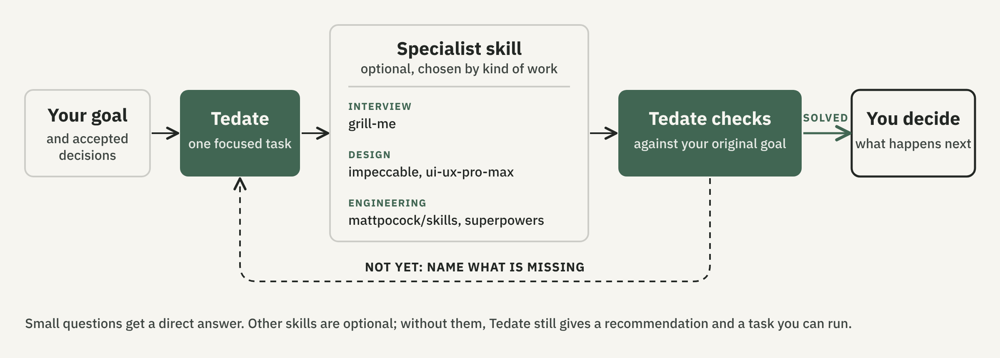

[English](README.md) · [简体中文](README.zh-CN.md) · **日本語**

# Tedate

> この README は英語版の翻訳です。内容に相違がある場合は、英語版を優先してください。

Claude Code と Codex で使える、プロダクトづくりの判断を支える skill です。何を作るか、何を変えるか、できあがったものが目的を果たしているかを判断する助けになります。

- **次の一手を選ぶ。** アイデアや機能の要望、「何かがおかしい」という違和感から、次に何をするかを具体的に提案します。
- **作業に方向を与える。** 目標と、すでに決めたことを踏まえ、デザインや実装を依頼するための具体的なタスクにまとめます。
- **結果を評価する。** 元の問題は解決したか、まだ何を直す必要があるか、どこで作業を終えるかを確認します。

agent は機能を作れます。その機能が必要か、使い心地はどうか、どこまで作れば十分かを決めるのはあなたです。こうした判断は、自分で agent に頼むこともできます。Tedate は、こうした判断を、使用時の基本的な進め方としてまとめた skill です。

**プロダクトを決めるのはあなた。作るのは agent です。**

*名前の由来は「手立て」（てだて）。物事を行うための方法や手段を意味します。*

[インストール](#インストール) · [使用例を見る（英語）](docs/examples.md) · [他の skill との連携（英語）](docs/working-with-other-skills.md)

プレビュー版 · MIT ライセンス · [知っておくべきこと](#知っておくべきこと)

## もう一度イテレーションしても改善しないとき

デザインをやり直してもらいました。ページはすっきりしたのに、利用者がやりたいことには、まだ役立っていません。

機能をもう一つ追加しました。きちんと動くけれど、このプロダクトで何をしたいのか、かえって分からなくなりました。

agent は「テストはすべて通った」と報告しています。それでも、元の問題が解決したのかは分かりません。

Tedate は、こうした場面で使うための skill です。今何が重要か、何を変え、何を残すか、何を確認できれば十分かを整理し、判断を言葉にします。

「作る」と提案することもあれば、分からない点を一つ調べる、範囲を絞る、今は手を加えない、と提案することもあります。

## チェックボックスは次の一手ではない

作者が Tedate を使ったある場面では、家族の健康情報をまとめたページが診察中に使いにくい、という相談をしました。

コードを読んだ agent は、機能上の不足かもしれない点を見つけました。ページには**「次にすることは分かっている」というチェック項目があるのに、具体的に何をするのかは記録されていませんでした。**診察ビューを閉じると、チェック状態も消えていました。

そこで、次に何をするかという提案も変わりました。デザインをやり直す前に、最近うまくいかなかった診察を一度振り返る。質問を準備するときか、回答を記録するときか、その後の行動を確認するときか。どこでページが役に立たなくなったのかを探る、という提案です。

もう一度作り直してもらう前に、何に取り組むべきかを見極める。Tedate が支えたいのは、こうした判断です。

[詳しい経緯と回答例を読む（英語）](docs/examples.md)

## 行き詰まっている判断を一つ持ってきてください

- **作るものが多すぎる：**「この中で、今取り組むべきアイデアはどれ？」
- **デザインを直してもしっくりこない：**「2つの案を試しました。まだ何がおかしいのでしょう？」
- **方向性を選びたい：**「やりたいことに一番合うのは、どの方法？」
- **agent は完了したと言っている：**「元の問題が本当に解決したと、何を見れば判断できる？」

状況に合った提案と、その理由が返ってきます。簡単な質問でなければ、まだ確認していないことや、次に誰が何をするかも示します。大きな判断では、どんな結果が出たら提案を見直すかも伝えます。

依頼内容をきれいにまとめておく必要はありません。実際に困った場面が一つあれば、そこから始められます。

## ビルドを通して目的を保つ

ソフトウェアには「同じことを繰り返さない」（don't repeat yourself）という原則があります。skill も同じです。インタビュー、デザイン、実装には、すでに優れた専門の skill があります。Tedate は同じものを作り直さず、それらと連携します。単独で判断を支えることもできますが、深く掘り下げる必要があるときは、専門の skill に引き継ぎます。

インタビュー系の skill でアイデアを掘り下げ、デザイン系の skill で体験を形にし、エンジニアリング系の skill で実装する。Tedate は、それぞれに目標と合意済みの判断を伝え、戻ってきた結果を最初の目的に照らして確認します。



たとえば、「このページをもっと良くして」という依頼を、「レシピのタイトルがはっきり目に入るようにする」「カードの間隔は既存のものを使う」という具体的なタスクにします。これは説明のための例です。修正後は同じページでこの2点を見直し、全体の仕上がりも確認します。

簡単な質問なら、その場で答えます。他の skill は必須ではありません。なくても、Tedate は提案と、そのまま取り組めるタスクを示せます。

作業が複数のセッションにまたがる場合は、合意済みの判断をプロジェクト内に短く記録します。ファイルに書き込むのは、あなたの了承があるときだけです。agent が自動でセッションをまたいで記憶できるようになるわけではなく、他の skill が引き継ぎ内容に従わないこともあります。

[引き継ぎの仕組み（英語）](docs/working-with-other-skills.md) · [回答例（英語）](docs/outputs.md)

## インストール

このリポジトリをクローンするか ZIP でダウンロードし、`SKILL.md` のあるフォルダを開いてください。

```bash
git clone https://github.com/fengyu20/tedate.git
cd tedate
```

`SKILL.md`、`references/`、`LICENSE` をまとめてコピーします。コピー先のフォルダ名は `tedate` にする必要があります。

### Claude Code

```bash
mkdir -p ~/.claude/skills/tedate
cp -R SKILL.md LICENSE references ~/.claude/skills/tedate/
```

新しいセッションで次のように入力します。

```text
/tedate このページ、何かしっくりこないのですが、理由が分かりません。
```

リクエストが skill の説明に合う場合は、自動で呼び出されることもあります。

### Codex

```bash
mkdir -p ~/.agents/skills/tedate
cp -R SKILL.md LICENSE references ~/.agents/skills/tedate/
```

続けて次のように入力します。

```text
$tedate このページ、何かしっくりこないのですが、理由が分かりません。
```

表示されない場合は、Codex を再起動してください。

Tedate は最初に、`advise`、`delegate`、`execute` のいずれかのモードを示します。Tedate が使われたかどうかの目安になりますが、大切なのは、その助言が実際の判断に役立つかどうかです。

更新するときは、クローンしたリポジトリを pull してから、ファイルをもう一度コピーしてください。アンインストールするには、skills ディレクトリから `tedate` フォルダを削除します。

## 知っておくべきこと

- **判断を誤ることがあります。** 出典や日付を確認するよう求めても、情報そのものが正しいとは限りません。最終的に決めるのはあなたです。
- **引き継ぎは環境に依存します。** 他の skill は必須ではなく、引き継ぎ内容に従うかどうかは、使う skill と環境によって変わります。[Tedate が引き継ぐ理由](#ビルドを通して目的を保つ)。Tedate は、[Impeccable](https://github.com/pbakaus/impeccable)、[gstack](https://github.com/garrytan/gstack)、PM skill パックなど、既存のプロダクト系・デザイン系の skill と重なる部分があります。
- **扱うのはプロダクトに関する判断です。** リリース、バージョン番号、マージコンフリクトの管理や、チャネル別のマーケティング施策の実行、PRD やロードマップの作成は行いません。
- **支払い・公開・デプロイなどの操作を決めるのはあなたです。** 明示的な了承なしに支払い・公開・デプロイを行わず、他の人への連絡は代行しない、というルールが指示されています。これはプロンプト上のルールであり、技術的に操作を制限する仕組みではありません。

質問やフィードバックは、[issue へどうぞ](https://github.com/fengyu20/tedate/issues)。
