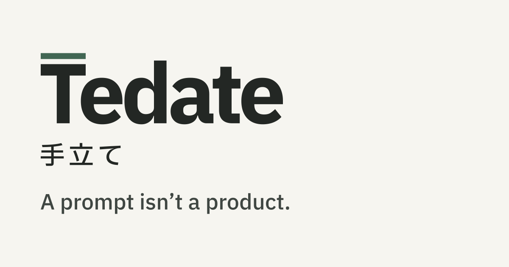

# Tedate

A product-judgment skill for Claude Code and Codex that helps you decide what to build, what to change, and whether the result works.

- **Choose the next move.** Turn an idea, a feature request, or “something feels wrong” into a clear recommendation.
- **Give the work direction.** Define a focused task for design or engineering, carrying your goal and the decisions you've already made.
- **Judge the result.** Check whether the work solved the original problem, what still needs attention, and when to stop.

Your agent can build the feature. You still have to decide whether it belongs, whether the experience works, and when to stop. You can ask your agent for any of this yourself; Tedate writes it down as a default way of working when you use it.

**You own the product. Your agent builds it.**

*Tedate takes its name from 手立て, Japanese for a way or means of doing something.*

[Install](#install) · [See it in use](docs/examples.md) · [Working with other skills](docs/working-with-other-skills.md)

Preview · MIT licensed · [Good to know](#good-to-know)

## When another iteration isn't helping

You ask for a redesign. The page gets cleaner, but still doesn't help someone do what they came to do.

You add another feature. It works, but you are less sure what the product is for.

Your agent reports that every test passes. You still don't know whether the original problem is solved.

These are the moments Tedate is written for. It helps make the judgment explicit: what matters here, what should change, what should stay, and what evidence would be enough.

Sometimes the recommendation is to build. Sometimes it is to investigate one uncertainty, reduce the scope, or leave things alone.

## A checkbox isn't a next step

In one of the author's runs, a family health-information page felt awkward to use at medical appointments.

Reading the code, the agent found a likely gap: the page let someone tick **“I know the next step,” but none of the ticks recorded what that step was.** The ticks also disappeared when the visit view closed.

The proposed next move changed. Before redesigning the page, replay one recent difficult appointment and find the moment it stopped helping: preparing questions, recording answers, or knowing what to do afterwards.

That is the kind of judgment Tedate is intended to support: finding a more useful problem to work on before asking for another version.

[Read the fuller account and an illustrative answer](docs/examples.md)

## Bring one decision you're stuck on

- **Too much to build:** “Which of these ideas deserves attention now?”
- **Another unsatisfying redesign:** “I've tried two versions. What is still wrong?”
- **A choice between directions:** “Which approach better serves what we're trying to do?”
- **An agent says it's done:** “What shows that the original problem is actually solved?”

Expect a recommendation and a reason tied to your situation. Anything beyond a small question also says what was not checked and who does what next, and a larger decision states what result would change the recommendation.

You don't need a finished brief. A real example of where things stop working is a useful place to start.

## Keep the purpose through the build

Software has a principle: don't repeat yourself. Skills are the same. Good specialist skills already exist for interviewing, design and engineering, and Tedate would rather work with them than rebuild them. It can handle a decision on its own, and it is designed to hand off to a specialist when a question needs deeper work.

Use an interview skill to explore the idea, a design skill to shape the experience, and an engineering skill to build it. Tedate helps carry the product goal and accepted decisions through those hand-offs, then checks the result against the original intent.

For example (illustrative), “make this page better” might become a focused design task: give the recipe title a clear visual priority and use the existing card spacing. The review then returns to those same issues on the same page, alongside whether the overall result works.

Small questions can stay small. Other skills are optional; without them, Tedate can still give a recommendation and an actionable task.

For work across sessions, Tedate keeps accepted decisions in a short record in your project, written only with your OK. It does not give your agent memory of its own, and another skill may not follow a hand-off.

[How the hand-offs work](docs/working-with-other-skills.md) · [What the answers look like](docs/outputs.md)

## Install

Clone this repository (or download it as a zip), then open the folder containing `SKILL.md`:

```bash
git clone https://github.com/fengyu20/tedate.git
cd tedate
```

Copy `SKILL.md`, `references/` and `LICENSE` together. The destination folder must be named `tedate`.

### Claude Code

```bash
mkdir -p ~/.claude/skills/tedate
cp -R SKILL.md LICENSE references ~/.claude/skills/tedate/
```

In a new session:

```text
/tedate This page looks off, but I can't say why.
```

It may also trigger when your request matches its description.

### Codex

```bash
mkdir -p ~/.agents/skills/tedate
cp -R SKILL.md LICENSE references ~/.agents/skills/tedate/
```

Then:

```text
$tedate This page looks off, but I can't say why.
```

If it does not appear, restart Codex.

Tedate opens by naming its mode: `advise`, `delegate` or `execute`. That is a sign it was used; the useful check is whether its advice helps you make a real decision.

To update, pull the repository if you cloned it, then copy the files again. To uninstall, remove the `tedate` folder from your skills directory.

## Good to know

- **Its judgment can be wrong.** Asking for sources and dates does not make the underlying facts correct. You make the call.
- **Hand-offs depend on your setup.** Other skills are optional, and whether one follows a hand-off depends on that skill and your environment. [Why Tedate hands off](#keep-the-purpose-through-the-build). Tedate overlaps with existing product and design skills such as Impeccable, gstack and PM skill packs.
- **Scope is product judgment.** It does not manage releases, version numbers or merge conflicts, run channel-specific marketing tactics, or produce PRDs or roadmaps.
- **You stay in charge of consequential actions.** It is instructed not to spend money, publish or deploy without your explicit yes, and never to contact people for you. These are prompt rules, not technical safeguards.

Questions or feedback? [Open an issue](https://github.com/fengyu20/tedate/issues).
